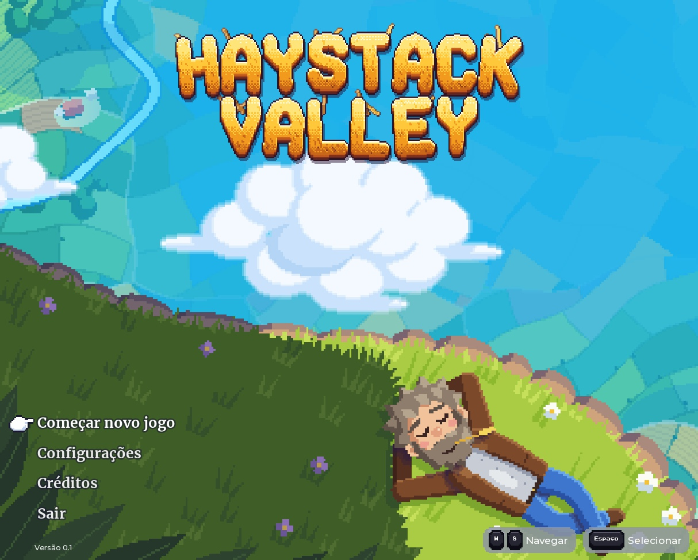
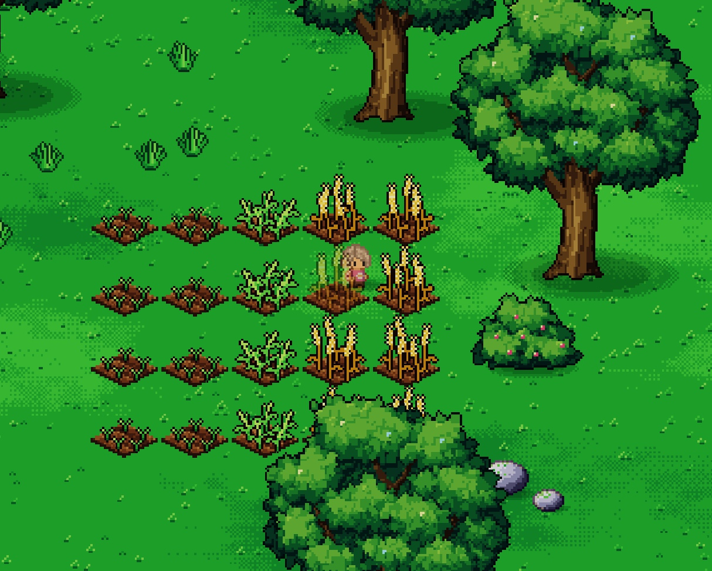
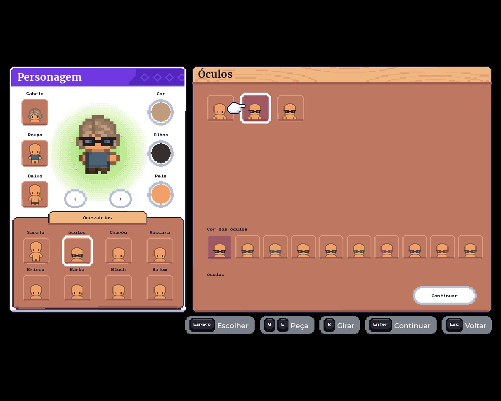
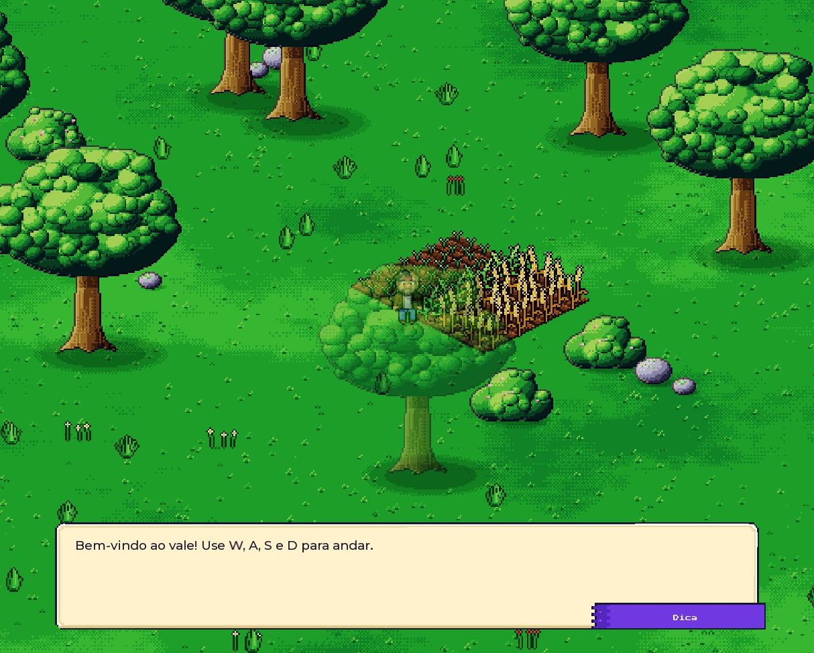

# Haywood Valley

A top-down pixel-art farming game for Roblox, in early development. It is written in TypeScript with roblox-ts and draws a 2D world inside Roblox's 3D engine: tiled interiors, an island with sea around it, a day-and-night cycle, characters in the Graal Online Classic format, and a map editor that runs inside Roblox Studio.

The game was called Haystack Valley until October 2026, which is the name still on the title screen below.

## Sneak peeks

| Title screen | Farm |
|---|---|
|  |  |

| Character creator | Dialogue |
|---|---|
|  |  |

## Technical stack

- **roblox-ts 3.0**, with TypeScript pinned to 5.5.3
- **Flamework** for services, controllers and networking
- **Charm** and **charm-sync** for state
- **Vide** for the interface, in the game and in the Studio plugin
- **Rojo 7.7** to send the compiled output to Roblox Studio, pinned with **Aftman**
- **Node** scripts for the generators and the editor bridge; **Python 3.12** (Pillow, numpy) for the sprite-sheet tools

## How the world is drawn

There is no 2D renderer in Roblox, so the world is a 3D scene arranged to read as 2D.

- **Ground.** One flat part with a `SurfaceGui` whose canvas is measured in art pixels. Three canvases share the plane: the still tiles, a live layer for whatever changes each frame (shadows, animated tiles, light halos, movable pieces) and the sea underneath, so the big canvas is never redrawn.
- **Standing objects.** Each one is a thin part facing the camera, with the sprite on a `SurfaceGui` and its bottom edge on the ground. Roblox draws them from farthest to nearest, which is already the right order.
- **Camera.** Fixed, looking north from 70 degrees above the horizon, far away and with the smallest field of view Roblox allows. The zoom is always a whole multiple of the art pixel, with three steps like Graal (270, 540 and 768 art pixels of height).
- **Compressed depth.** Everything drawn is pushed along the line of sight until its depth is 1% of the real one. The screen position does not change, the ground ends up almost facing the camera, and the perspective error that used to double or drop rows of pixels falls below half a screen pixel. Physics stays where it is; only the drawing moves.
- **Scale.** 32 art pixels per stud. Interiors use 16-pixel tiles, half a stud wide.
- **Interiors in tiles.** Maps painted in the editor arrive as generated modules: a palette of tiles from the artist's sheets, three layers (floor, object, front) as text, and derived block, action, spawn, exit, zone and resident data. Neighbouring cells that are neighbours on the sheet merge into one image; single-colour tiles become one stretched image.
- **Linked maps.** Each map lives in its own spot of the world, 512 studs apart, so players on different maps never meet or get streamed to each other. Exits work like Graal's `LINK`: the client asks, the server checks and moves the character behind a short black veil. A player's house is a private copy with its own decoration.
- **Residents.** Characters placed by the map author stand, sit or lie in the map, blink, take the light and the time of day, and share the puppet pool with players.
- **Day and night.** One game clock drives a tint multiplied into the colour of every image in the world, pixel light halos in the artist's palette (torches, fireplaces, lamps), sunlight and moonlight through windows, and night versions of window tiles. No Roblox lighting touches the sprites.
- **Decoration.** In their own house a player places, moves, rotates and stores furniture with the same floor-matching and wall-fitting rules the map editor uses. The server verifies every request with the same shared code.
- **Wind and occlusion.** Trees, bushes and crops sway in a wave across the map; an object covering the player turns partly transparent, as the tree does in the dialogue capture above.
- **Characters.** The Roblox avatar is invisible, minimal and only moves and collides. Every client draws each player and resident from up to 15 tinted sprite layers.

Everything else derives from a handful of constants in [`src/shared/view.ts`](src/shared/view.ts), so changing the view means changing that one file.

## Systems

- **Graal character format.** Heads and bodies drawn by contributors of the Graal community, in 32x32 cells, with a grey mask per paintable part (skin, hair, eyes, details, up to six cloth parts) tinted at runtime. Each piece exists in two styles: recoloured into the tile artist's palette and the contributor's original. Walking and sitting follow the standard `walk.gani` and `sit.gani`. Contributors are credited in-game.
- **Character look.** A look is the gender, a head, a body, one RGB value per part (or "original") and the style of each piece. The client sends it as a short string and the server accepts only what the catalog contains.
- **Actions.** Sitting, lying, swimming, wading, pushing, holding and pulling, lifting, carrying and throwing pieces of furniture, chests, stoves, taps and sleeping to skip the night, as in Graal Online Classic.
- **Diorama, the map editor.** A Roblox Studio plugin (`plugin/`) with a map editor, a tile catalog, an asset panel, a server panel and a diagnostics panel. It talks to the repository through a local HTTP **bridge** (`tools/diorama_ponte.mjs`), and **generators** turn the saved JSON blocks into the TypeScript modules the game compiles, byte for byte; an importer goes the other way.
- **Assets registry.** `assets/registro.json` maps every image and sound key to its Roblox id and generates `src/shared/assets.ts`.
- **Interface.** Drawn for a 480x270 canvas and enlarged by a whole factor, with two switchable themes (a farm kit and a classic online-game kit), a pixel font, and nine-sliced panels generated by script.
- **i18n.** English is the source language; Brazilian Portuguese is checked against it by the type system. "Auto" follows the player's Roblox locale.
- **Player data.** A Roblox DataStore with a session lock, periodic saves and a rate limiter on client requests: the confirmed character, favourites, saved looks and house decoration.
- **Sound and music.** Ambience by zone and time of day, placed sounds, effects and a music director that breathes between tracks, all on the client.
- **Flow.** A black opening screen from `ReplicatedFirst`, title menu, character creator, then the game.
- **Dev tools.** A performance panel (images, cards, puppets, per-system frame time, canvas redraws, memory, network, against targets for a low-end phone) and a phone preview.

## Project layout

| Path | Contents |
|---|---|
| `src/server/services` | Flamework services: world, characters, appearance, maps, pieces, fixtures, decoration, player data, names, reactions |
| `src/client/controllers` | Flamework controllers: camera, scene, characters, residents, movement, actions, maps, decoration, daylight, sound, music, dialogue, moods, chat, dev tools |
| `src/client/world` | The scene: ground, cards, interiors, puppets, pieces, lights, water, wind, occlusion, colliders |
| `src/client/ui` | Vide screens, the interface kit, themes, the pixel font |
| `src/shared` | View maths, appearance, Graal data, interior maps and rules, decoration rules, sounds, player data, i18n, network definitions |
| `luau/` | The two scripts written directly in Luau (`ReplicatedFirst` opening, empty `Animate` and `Health`) |
| `plugin/` | The Diorama map editor, a separate roblox-ts project built into a `.rbxm` |
| `tools/` | The bridge, the map generator and importer, the assets registry, the Graal sheet packer and the palette study |
| `diorama/` | Map blocks, the tile catalog and the tile sheets the editor and the generator read |
| `assets/` | The registry of Roblox ids, the game's own images and the licence notes |
| `docs/` | The Diorama specification and bridge API, the palette study, the recovery plan, the captures above |

## Code samples

Comments in the source are in Portuguese.

### The view, in a few constants

From [`src/shared/view.ts`](src/shared/view.ts): the directions of the screen in world space, and the conversion between ground positions and art pixels.

```ts
/** Direita da tela, no mundo. */
export const SCREEN_RIGHT = Vector3.xAxis;
/** Direção do chão que aponta para a câmera: é o "para baixo" da tela. */
export const TOWARD_CAMERA = Vector3.zAxis;
/** Para cima da tela, no mundo. */
export const SCREEN_UP = new Vector3(0, COS_PITCH, 0).sub(TOWARD_CAMERA.mul(SIN_PITCH));
/** Direção em que a câmera olha. */
export const LOOK = TOWARD_CAMERA.mul(-COS_PITCH).sub(new Vector3(0, SIN_PITCH, 0));

/** Studs de chão, na direção da câmera, que valem um pixel de arte na vertical da tela. */
export const GROUND_STUDS_PER_PX = 1 / (ART_PX_PER_STUD * SIN_PITCH);

/** Deslocamento no chão que move um ponto (px, py) pixels de arte na tela: x para a direita, y para baixo. */
export function groundOffset(px: number, py: number) {
	return SCREEN_RIGHT.mul(px / ART_PX_PER_STUD).add(TOWARD_CAMERA.mul(py * GROUND_STUDS_PER_PX));
}

/** Leva um ponto do chão ao pixel de arte mais próximo, para o que se move não ficar entre dois pixels. */
export function snapToArtPx(position: Vector3) {
	const px = worldToArtPx(position);
	return groundOffset(math.round(px.X), math.round(px.Y));
}
```

### Compressing the depth

Also from [`src/shared/view.ts`](src/shared/view.ts): where a point of the world is drawn. Same place on screen, one hundredth of the depth.

```ts
export const VIEW_DEPTH_SCALE = 0.01;

/** Onde um ponto do mundo é desenhado: o mesmo lugar na tela, com a profundidade comprimida. */
export function toView(position: Vector3) {
	return position.sub(LOOK.mul(position.Dot(LOOK) * (1 - VIEW_DEPTH_SCALE)));
}
```

### Placing a sprite in the world

From [`src/client/world/card.ts`](src/client/world/card.ts): where a camera-facing card goes so that a chosen point of the sprite lands on a ground position.

```ts
export function cardCFrame(size: Vector2, anchor: Vector2, position: Vector3) {
	const bottom = position.add(groundOffset(size.X / 2 - anchor.X, size.Y - anchor.Y));
	const center = bottom.add(SCREEN_UP.mul(size.Y / 2 / ART_PX_PER_STUD));
	// A face Front fica virada para a câmera.
	return CFrame.fromMatrix(toView(center), SCREEN_RIGHT.mul(-1), SCREEN_UP, LOOK);
}
```

### Validating what the client sends

From [`src/shared/appearance.ts`](src/shared/appearance.ts): the server reads a character look and refuses anything that is too long, incomplete or not in the catalog. Looks saved before piece styles existed are still accepted.

```ts
export function parseLook(text: unknown): Look | undefined {
	if (!typeIs(text, "string")) return undefined;
	// O texto vem do cliente: conferir o tamanho antes de dividir.
	if (text.size() > MAX_LOOK_TEXT) return undefined;
	const parts = text.split(",");
	if (parts.size() !== FIELDS.size() && parts.size() !== FIELDS_BEFORE_STYLES) return undefined;

	const look: Look = { ...DEFAULT_LOOK, headStyle: LEGACY_PIECE_STYLE, bodyStyle: LEGACY_PIECE_STYLE };
	for (let index = 0; index < parts.size(); index++) {
		const field = FIELDS[index];
		const value = tonumber(parts[index]);
		if (value === undefined || value !== math.floor(value)) return undefined;
		if (value < field.min || value >= field.min + field.count()) return undefined;
		(look as unknown as Record<keyof Look, number>)[field.key] = value;
	}
	return look;
}
```

## Build and sync

Install the dependencies once:

```bash
npm install
aftman install
```

To work, keep two terminals open at the root of the project:

```bash
npm run watch   # compiles src/ to out/ on every change
npm run serve   # sends out/ to Roblox Studio with Rojo
```

In Roblox Studio, open the place, open the Rojo panel and press Connect.

For the map editor:

```bash
npm run plugin:build    # builds the Diorama plugin into %LOCALAPPDATA%\Roblox\Plugins\Diorama.rbxm
npm run diorama:ponte   # the bridge the plugin talks to, on http://127.0.0.1:34873
npm run diorama:jogo -- <map>   # turns a saved map block into src/shared/interiors/<map>.ts
npm run assets          # regenerates src/shared/assets.ts from assets/registro.json
```

## Art

The world, the interface, the title illustration and the lights are drawn by script for this game. Interior tiles are by Aeko, from the Graal community. Character heads and bodies are by Graal community contributors, credited in-game; their sheets are kept out of the repository until the licences are confirmed. The reaction bubbles come from a licensed asset pack that is not part of this repository.

## Recovery

In October 2026 the development machine lost its disk. The game code was rebuilt in TypeScript from the Luau compiled into the Roblox place (it compiles back to the same files), the images were downloaded from Roblox, and the editor, bridge and generators were reconstructed from what the code requires. What is a guess is marked as such in the documents; see [`docs/PLANO_RECUPERACAO.md`](docs/PLANO_RECUPERACAO.md).
