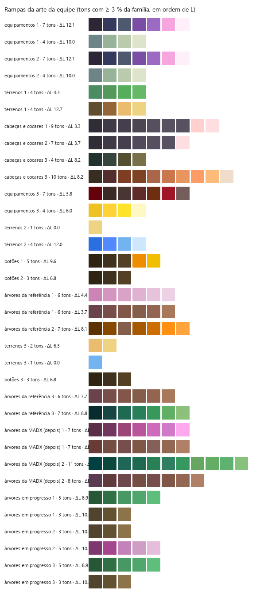

# Estudo: a paleta do Aeko, e o Aeko + equipe

Gerado por `tools/estudo_aeko.py` em 2026-10-20, a partir do que sobreviveu à formatação: as folhas de tiles do
Aeko (`aeko.casa.0/1`, `aeko.castelo.0/1`), as 947 peças dos contribuidores do Graal nos dois estilos
(`graal.aeko.<n>.png` e `graal.original.<n>.png`, casadas célula a célula) e `src/shared/graalData.ts` e
`graalDataOriginal.ts`. As imagens estão em `estudo/aeko/`. O que é dedução sobre a ferramenta perdida
(`tools/estilo_aeko.py`, que recoloria as peças da equipe na paleta do Aeko) está marcado **(palpite)**.

Em uma frase: nos tiles, o Aeko pinta com poucas cores (451 em quatro folhas), contorno preto puro e
rampas que descem para o preto perdendo croma, quase sem girar o matiz; nas peças da equipe, a ferramenta perdida não
aplicava essa paleta, e sim o jeito dela: pôs o contorno preto e reduziu os tons de cada parte à metade
(degraus de L duas vezes maiores), mantendo o matiz e o croma do contribuidor.

## 1. A paleta do Aeko nos tiles

Só os tiles de 16×16 sem pixel do quadriculado das exportações (634,880 pixels).

- **451 cores** distintas. O preto do contorno (`010000`) é 3.5 % dos pixels; cinzas
  (croma < 6) 25.9 %.
- Croma médio das cores com matiz: **30** (Lab). Luminosidade entre 6 e 89 (p5–p95).
- Famílias de matiz (9 com mais de 0,4 % dos pixels): em média **7.2 tons** por família
  (tons com ≥ 3 % dos pixels da família; uma família junta as rampas de vários objetos do mesmo matiz, então é
  mais que uma rampa), **ΔL mediano de 4.2** entre tons vizinhos de uma família.
- Sombra: o tom mais escuro de cada família tem croma 20 e o mais claro 47 (em média):
  a sombra do Aeko vai na direção do preto, perdendo croma, não de uma cor saturada; o matiz gira
  -2° do escuro para o claro (mediana das famílias), ou seja, quase não há hue shift (as exceções
  estão na tabela: o amarelo esverdeia ao clarear, o azul vai para o roxo ao escurecer). O contorno é preto
  puro em volta de tudo, não um escuro da própria cor — nas peças originais dos contribuidores o contorno é um
  escuro da cor da parte (ver a seção 2).

| família | pixels | tons | ΔL mediano | croma médio | croma escuro → claro | matiz escuro → claro |
|---|---|---|---|---|---|---|
| azul (280°) | 20.1 % | 7 | 3.4 | 20 | 14 → 20 | 280° → 268° |
| amarelo-terra (54°) | 16.0 % | 9 | 4.3 | 41 | 26 → 50 | 57° → 57° |
| laranja (39°) | 12.5 % | 8 | 2.6 | 36 | 11 → 50 | 43° → 32° |
| amarelo (95°) | 10.1 % | 7 | 4.7 | 17 | 6 → 16 | 86° → 107° |
| verde (139°) | 4.0 % | 5 | 7.5 | 37 | 33 → 38 | 136° → 145° |
| rosa (334°) | 3.8 % | 9 | 6.2 | 32 | 20 → 38 | 328° → 329° |
| amarelo-terra (66°) | 2.2 % | 8 | 2.6 | 54 | 40 → 84 | 68° → 65° |
| verde (158°) | 0.7 % | 5 | 5.7 | 27 | 16 → 33 | 163° → 157° |
| roxo (298°) | 0.6 % | 7 | 5.0 | 50 | 16 → 94 | 309° → 295° |

## 2. As peças: original × Aeko

Medido nas 947 peças (camada f de cada uma), separando as partes pelas máscaras (cabelo h, pele s, olhos e,
enfeites d, roupa c). Pixels pretos (contorno) fora das contas de tons.

- Cores por peça: **41 no original → 19 no Aeko**.
- Contorno: no original, 8.9 % dos pixels da borda da silhueta são pretos (L médio da borda
  19); no Aeko, **100.0 %**. O preto é 20.1 % dos pixels de uma
  peça no Aeko, 3.7 % no original.
- Tons por parte, degraus e croma:

| parte | tons (orig → Aeko) | ΔL entre tons (orig → Aeko) | croma médio (orig → Aeko) | matiz escuro→claro (orig → Aeko) |
|---|---|---|---|---|
| cabelo | 5.8 → 3.5 | 4.2 → 8.0 | 17 → 17 | +1.3° → +6.9° |
| pele | 8.9 → 4.0 | 3.7 → 11.0 | 44 → 47 | +26.3° → +25.2° |
| olhos | 7.5 → 4.2 | 7.4 → 15.1 | 31 → 30 | -0.9° → +0.0° |
| enfeites | 4.8 → 2.7 | 2.0 → 8.5 | 36 → 36 | +0.1° → -0.8° |
| roupa | 1.5 → 1.4 | 8.6 → 12.0 | 33 → 34 | +0.7° → +1.5° |

Leitura: a ferramenta cortou os tons pela metade e dobrou os degraus de L (uns 8 no cabelo, 11 na pele);
o croma e o matiz das partes ficaram os do contribuidor (a diferença média de cor entre os dois
estilos, fora o contorno, é de 3 a 5 de ΔE, e a projeção dessa diferença na direção da cor mais próxima da
paleta dos tiles é zero). Nenhuma cor das peças no estilo Aeko aparece nos tiles, a não ser o preto.

## 3. O que a ferramenta perdida fazia (dedução)

1. **Contorno preto `010000`**: todo pixel opaco que encosta na transparência (97 % deles no gabarito) e os
   pixels fora das máscaras com canal máximo abaixo de ~36 (o contorno escuro que o contribuidor pintou).
   O `01` no vermelho vem de converter o preto por Lab e voltar **(palpite)**. O alfa não muda nunca.
2. **Redução de tons por parte**: cada parte pintável perde metade dos tons; os que se fundem viram
   aproximadamente a média ponderada em Lab (é a melhor das hipóteses testadas: médias em RGB, RGB linear,
   HSV, mediana e moda saem piores). O critério de fusão **não foi recuperado**: nenhum limiar de ΔL, ΔE ou
   RGB separa os pares que se fundiram dos que não (70 % de acerto no melhor caso), duas cabeças com a mesma
   forma e os mesmos degraus (aly1pink-4 e aly1green-3) saíram com 1 e 3 tons de cabelo, e os quantizadores
   do Pillow (median cut, octree, max coverage) não reproduzem o gabarito (0 % de pixels iguais). Pode ter
   sido um k-means com inicialização instável **(palpite)**.
3. **Sem paleta fixa**: as cores não foram encaixadas na paleta dos tiles.
4. **Pequenos ajustes**: pele escura mais saturada (+20 % de croma em L 30–50), olhos claros menos (−10 %),
   cabelo com o contraste de L ampliado uns 10 %.
5. **Resto intocado**: o que fica fora das máscaras e não é escuro sai igual (ΔE médio 0,3).

A reconstrução (`tools/estilo_aeko.py`) faz 1, 3, 4 e 5 como medido, e para 2 usa famílias de matiz (corda em
(a, b) de Lab) com partição ótima em L (Jenks), K = round(amplitude de L / degrau) + 1, degrau 7 no cabelo, 26
na pele e 9 no resto. Com os agrupamentos do próprio gabarito (o "oráculo") e as médias em Lab o ΔE médio
ficaria em 2,6: é o teto do método "fundir e tirar a média"; o que falta é a cor exata que a ferramenta dava a
cada grupo.

## 4. Evolução da recolorização

| passo | o que mudou | ΔE médio (200 peças) | observação |
|---|---|---|---|
| 1 | só o contorno preto (borda e resto escuro) e os tons como estão | 3,26 | — |
| 2 | + fusão de tons por Ward normalizado em Lab (limiar 3) | 3,54 | pior: funde tons grandes que o Aeko manteve |
| 3 | Ward com limiar 1,5 | 3,25 | quase nada |
| 4 | famílias de matiz (a, b) + partição ótima em L (Jenks), degraus 7/13/9 | 3,31 | pele piora: a rampa se parte pelo croma |
| 5 | famílias pela corda de matiz (croma geométrico), sem os ajustes lineares | 3,13 |  |
| 6 | degrau da pele 26, tons pequenos contam na amplitude, sem o preto-na-parte | 3,06 |  |
| 7 | croma por L (pele escura +20 %, olhos claros −10 %), beirada da célula não é contorno | 3,02 | nas 947 peças: ΔE 3,04; a nota está no resumo |
| 8 | grade final nas 947 peças: família de matiz 20 e limiar do preto 40 | 3,02 | +0,01 de nota cada; degrau do cabelo 6 e dos olhos 14 pioram |

## 5. Nota e comparação (resumo)

Rodada de `tools/comparar_estilos.py` sobre 947 peças: **nota média 5.57**, ΔE médio 3.02, pixels iguais 26.8 %, na paleta do gabarito (a um JND) 63.7 %, F1 do contorno 0.966.

Ranking "Aeko + equipe" (média das notas por contribuidor, só os com 5 peças ou mais; a tabela inteira está em `estudo/comparacao/notas.md`):

| # | autor | peças | nota média |
|---|---|---|---|
| 1 | bear | 12 | 6.21 |
| 2 | daisy | 22 | 5.83 |
| 3 | gong | 9 | 5.80 |
| 4 | bea | 219 | 5.73 |
| 5 | zar | 458 | 5.68 |
| 6 | ena | 18 | 5.41 |
| 7 | aly | 6 | 5.29 |
| 8 | raskit | 50 | 5.29 |
| 9 | pooka | 28 | 5.06 |
| 10 | nima | 23 | 5.02 |
| 11 | jen | 49 | 4.87 |
| 12 | tal | 15 | 4.64 |
| 13 | chan | 9 | 4.46 |

## 6. Estilo equipe, e o Aeko + equipe

Gerado por `tools/estudo_aeko.py --referencia` em 2026-10-20. A ferramenta perdida de arte nova tinha três estilos:
**aeko** (o do Aeko: gabarito nas folhas `casa`/`castelo` e nas peças do Graal no estilo Aeko), **equipe** (a arte que a
equipe fez sem a mão do Aeko) e **aeko+equipe** (a mistura dos dois). Atenção: na seção 5, "Aeko + equipe" é o nome
antigo do ranking das peças dos contribuidores recoloridas; aqui é o terceiro estilo.

O gabarito do estilo equipe fica em `Documents\Haywood-Valley-recuperado\` (fora do repositório; aqui entram só os
números e a paleta, em `tools/estilos_arte.json`):

- `aeko\referencia_estilo_equipe.png`: 57 objetos (terrenos, botões, cabeças e cocares, equipamentos, árvores) sobre
  um fundo chapado `#B0C6CE`, ampliados 2× (cada pixel de arte é um bloco 2×2; o estudo reduz antes de
  medir). Os objetos são os componentes 8-conexos fora do fundo, com 24 pixels ou mais; a categoria sai do tamanho e
  do lugar na folha.
- `equipe\arvores_antes_depois_madx.png`: captura com ampliação fracionária (~5,23×) e ruído de JPEG. A ferramenta
  acha a grade pela energia das bordas (Fourier), toma a mediana do miolo de cada pixel e junta as cores a menos de
  ΔE 5 (`desamostrar_captura`). As duas árvores da direita (o "depois") entram aqui; o par antes → depois serve à
  validação (ESTILO_AEKO_ARTE.md).
- `equipe\arvores_em_progresso.png`: captura do Aseprite em zoom 6× sem perdas (`grade_inteira`); o quadriculado e o
  verde chapado de fundo saem, a interface encosta na moldura e sai.
- `equipe\folha_tiles_1.png` e `folha_tiles_2.png` (2048×512, nativas), em janelas de 32×32 como as do Aeko; janelas de
  uma ou duas cores (preenchimento) ficam de fora. O detalhe e os recortes da mesma pasta são pedaços ampliados dessas
  folhas e não entram de novo.

Todos os conjuntos são medidos pela mesma função (`medir_objeto` em `tools/estilo_aeko_arte.py`). Nas janelas das
folhas, o quadriculado (Aeko) ou o alfa (equipe) é a transparência e a beirada da janela não conta como borda; as peças
do Graal entram pela célula de frente da camada f (200 sorteadas). Tons: os de uma família de matiz
com ≥ 3 % dela, nas famílias com ≥ 8 % do objeto.

| medida | folhas do Aeko (janelas 32×32) | peças do Graal no estilo Aeko | peças do Graal no original | objetos da equipe (referência e árvores) | folhas de tiles da equipe (janelas 32×32) |
|---|---|---|---|---|---|
| objetos medidos | 522 | 200 | 200 | 63 | 1578 |
| cores por objeto (mediana) | 11 | 17 | 34 | 26 | 6 |
| cores por 100 pixels (mediana) | 1.2 | 2.3 | 4.6 | 3.8 | 0.6 |
| tons por família com matiz | 3.6 | 4.4 | 6.0 | 5.2 | 3.3 |
| ΔL entre tons vizinhos (mediana) | 8.7 | 8.3 | 4.9 | 7.6 | 12.4 |
| croma do tom mais escuro ÷ o maior | 0.63 | 0.68 | 0.72 | 0.57 | 0.58 |
| giro do matiz, escuro → claro (graus) | -0 | 14 | 7 | 7 | -2 |
| croma médio (sem a tinta) | 26 | 30 | 29 | 29 | 31 |
| beirada preta (canal ≤ 4) | 7.2 % | 89.2 % | 5.2 % | 27.5 % | 0.0 % |
| beirada de tinta (L < 14) | 24.1 % | 95.2 % | 63.7 % | 59.8 % | 0.0 % |
| beirada escura (L < 30) | 51.2 % | 96.7 % | 77.6 % | 79.3 % | 21.0 % |
| L médio da beirada | 36 | 3 | 19 | 18 | 44 |
| contorno de 2 px (tinta da beirada com tinta por dentro) | 24.7 % | 59.0 % | 53.5 % | 33.1 % | 0.0 % |
| tinta por dentro (linhas escuras) | 16.6 % | 32.7 % | 31.4 % | 16.6 % | 5.9 % |
| xadrez (janelas 2×2 em xadrez) | 0.2 % | 0.8 % | 1.4 % | 1.7 % | 3.1 % |
| pixels isolados (sem vizinho da mesma cor) | 4.1 % | 12.7 % | 24.0 % | 25.9 % | 0.5 % |
| pixels com a cor exata da paleta do Aeko | 100.0 % | 22.2 % | 3.3 % | 1.6 % | 2.1 % |
| pixels a um JND da paleta do Aeko | 100.0 % | 46.7 % | 41.9 % | 29.6 % | 12.9 % |
| ΔE médio à cor mais perto da paleta do Aeko | 0.0 | 4.2 | 4.5 | 5.2 | 7.5 |

Por categoria dos objetos da equipe:

| categoria | objetos | cores (mediana) | tons | ΔL | beirada escura | beirada preta | L da beirada | pixels na paleta do Aeko (JND) |
|---|---|---|---|---|---|---|---|---|
| terrenos | 3 | 28 | 3.0 | 6.7 | 0.3 % | 0.0 % | 68 | 3.7 % |
| botões | 4 | 16 | 3.5 | 7.0 | 100.0 % | 0.0 % | 8 | 6.5 % |
| cabeças e cocares | 20 | 39 | 5.8 | 8.2 | 84.5 % | 37.8 % | 13 | 32.7 % |
| equipamentos | 26 | 24 | 5.0 | 6.9 | 87.6 % | 37.4 % | 13 | 41.5 % |
| árvores da referência | 4 | 23 | 6.4 | 6.6 | 55.8 % | 0.0 % | 35 | 3.9 % |
| árvores da MADX (depois) | 2 | 238 | 8.2 | 5.7 | 63.2 % | 2.2 % | 26 | 4.6 % |
| árvores em progresso | 4 | 12 | 4.2 | 9.3 | 69.3 % | 0.0 % | 24 | 16.6 % |

### O que muda do Aeko para a equipe

- **Contorno.** No Aeko o contorno é o preto `010000`, sempre o mesmo, em volta de tudo que encosta no transparente
  (89.2 % da beirada das peças). Na equipe o contorno é escuro mas raramente o mesmo preto
  (27.5 % da beirada é preto puro; 83.2 % é escura, L < 30, sem os terrenos): pretos que variam de
  objeto para objeto (`000000`, `080808`, `121212`, `1B1B1B`; o mais comum é `000000`), um marrom escuro nos
  botões e **contorno da própria cor** nas árvores, no capim e no cristal da coroa (verde-petróleo, roxo escuro; L da
  beirada 35 nas árvores da referência, 26 nas da MADX). Os terrenos não têm contorno.
- **Cores e tons.** Os objetos da equipe têm mais cores (26 na mediana, contra
  17 nas peças no estilo Aeko) e mais tons por rampa (5.2 contra 4.4 nas peças), com degraus
  de L parecidos (7.6 contra 8.3); algumas cabeças têm centenas de cores (degradê liso no cabelo), o
  que o Aeko nunca faz. Já as folhas de tiles da equipe são mais econômicas que as do Aeko: 6 cores por
  janela (Aeko: 11), 3.3 tons e degraus de 12.4 (Aeko: 3.6 e 8.7).
- **Paleta.** Só 29.6 % dos pixels dos objetos da equipe e 12.9 % das folhas dela ficam a um JND
  da paleta do Aeko, contra 100.0 % nas folhas do Aeko: a equipe não prende as cores à paleta dele.
- **Sombra e matiz.** Os dois descem ao escuro perdendo croma (o tom mais escuro com 0.57 do croma do mais
  saturado nos objetos da equipe, 0.58 nas folhas dela; 0.63 nas folhas do Aeko, 0.68 nas peças). O
  matiz gira pouco do escuro ao claro nos dois (7° e -2° na equipe; -0° e 14° no Aeko).
- **Textura.** Os objetos da equipe têm mais pixels isolados (25.9 %, contra 4.1 % nas folhas do Aeko):
  folhagem e cabelo ruidosos (a MADX passa a árvore lisa para folhagem picada). Xadrez (dithering) é raro em todos.

### Os alvos da ferramenta (`tools/estilos_arte.json`)

| alvo | tons | degrau de L | croma da sombra | giro | contorno (fração da beirada) | cor do contorno | paleta |
|---|---|---|---|---|---|---|---|
| aeko | 4.04 | 8.50 | 0.66 | +7° | 89.2 % preta | `010000` | as 442 cores das folhas com 4 pixels ou mais |
| equipe | 4.26 | 10.00 | 0.57 | +2° | 83.2 % escura | `000000` | as 1753 cores da equipe (≥ 2 px) |
| aeko+equipe (m) | m·aeko + (1−m)·equipe | idem | idem | idem | idem, por pixel | a do aeko se m ≥ 0,5 | as duas, a do outro lado afastada |

Cada alvo junta, nas rampas (tons, degrau, sombra, giro), as folhas e os objetos do mesmo autor em partes iguais:
folhas do Aeko e peças no estilo Aeko; folhas da equipe e objetos da equipe. O contorno vem dos objetos (as folhas
quase não encostam no transparente), sem os terrenos da equipe. A paleta da equipe são as cores com 2 pixels ou mais
dos objetos e das folhas dela.

**A mistura aeko+equipe (palpite)**: cada número é a média ponderada `m·aeko + (1−m)·equipe`, com `m = --mistura`
(padrão 0,5); um pixel da beirada conta como contorno `m` vezes "é preto (canal ≤ 4)" mais `1−m` vezes "é escuro
(L < 30)"; a paleta é a união das duas, e ao prender um tom a distância a uma cor do Aeko é multiplicada por
`1 + 0,5·(1−m)` e a uma da equipe por `1 + 0,5·m` (com m = 0,5 as duas pesam igual). A cor do contorno é a do aeko
com m ≥ 0,5 e a da equipe abaixo.

### A nota de aderência ao estilo

`nota_estilo` (em `tools/estilo_aeko_arte.py`) dá 0–10: 35 % paleta (pixels a um JND da paleta do alvo), 25 % contorno
(fração da beirada que é contorno do alvo ÷ a fração do gabarito, até 1), 15 % tons, 15 % degrau e 10 % croma da
sombra. Os três últimos são limites de um lado só, porque é isso que o estilo pede: no máximo alvo + 1 tons por
família (zera 3 tons acima disso), degrau de L de pelo menos alvo − 2 (zera 5 abaixo), sombra com no máximo
alvo + 0.15 de razão de croma (zera 0.4 acima). Menos tons, degraus maiores ou sombra mais neutra não tiram
nota. Uma versão com tolerância dos dois lados deu uns 0,5 nessas três partes em todos os conjuntos (a variação de
objeto para objeto engolia a diferença entre os estilos) e foi trocada. Pesos e limites são escolha desta
reconstrução. A nota média de cada gabarito contra cada alvo (as janelas das folhas e os terrenos sem o contorno):

| gabarito | aeko | equipe | aeko+equipe |
|---|---|---|---|
| folhas do Aeko (janelas 32×32) | 9.65 | 5.73 | 9.56 |
| peças do Graal no estilo Aeko | 7.66 | 8.03 | 8.19 |
| peças do Graal no original | 4.44 | 6.45 | 5.96 |
| objetos da equipe (referência e árvores) | 5.28 | 8.98 | 8.48 |
| folhas de tiles da equipe (janelas 32×32) | 5.63 | 9.75 | 9.81 |

A nota separa os estilos sobretudo pela paleta e pelo contorno: as folhas do Aeko tiram 9.65 no aeko e
5.73 no equipe; as folhas da equipe, 9.75 no equipe e 5.63 no aeko; os objetos da equipe,
8.98 no equipe e 5.28 no aeko. As peças do Graal no estilo Aeko ficam no meio (7.66 no aeko e
8.03 no equipe): a ferramenta das peças pôs o contorno e reduziu os tons, mas não prendia as cores à paleta das
folhas (seção 3), e o alvo aeko é essa paleta fechada. As peças originais dos contribuidores caem mais no aeko
(4.44), pelo contorno da própria cor e pelos tons demais.
