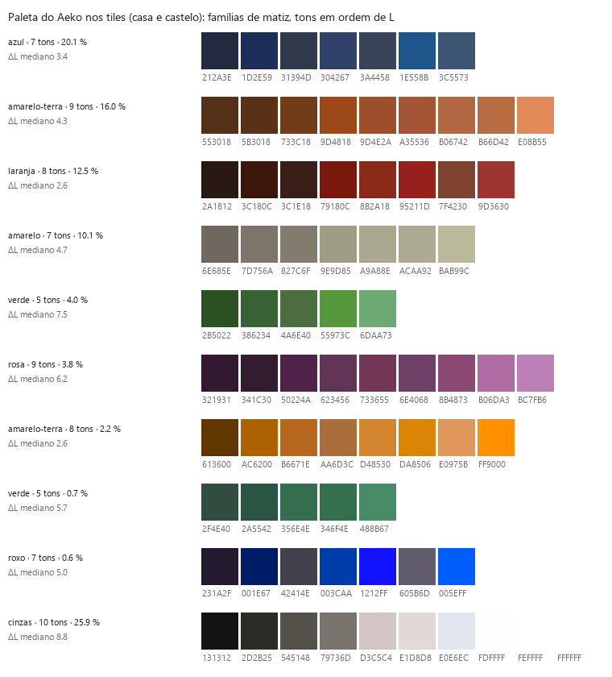
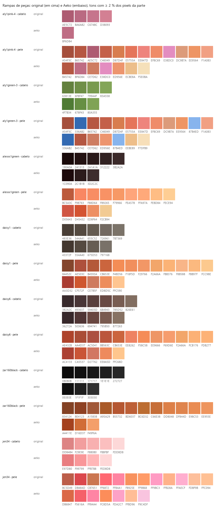
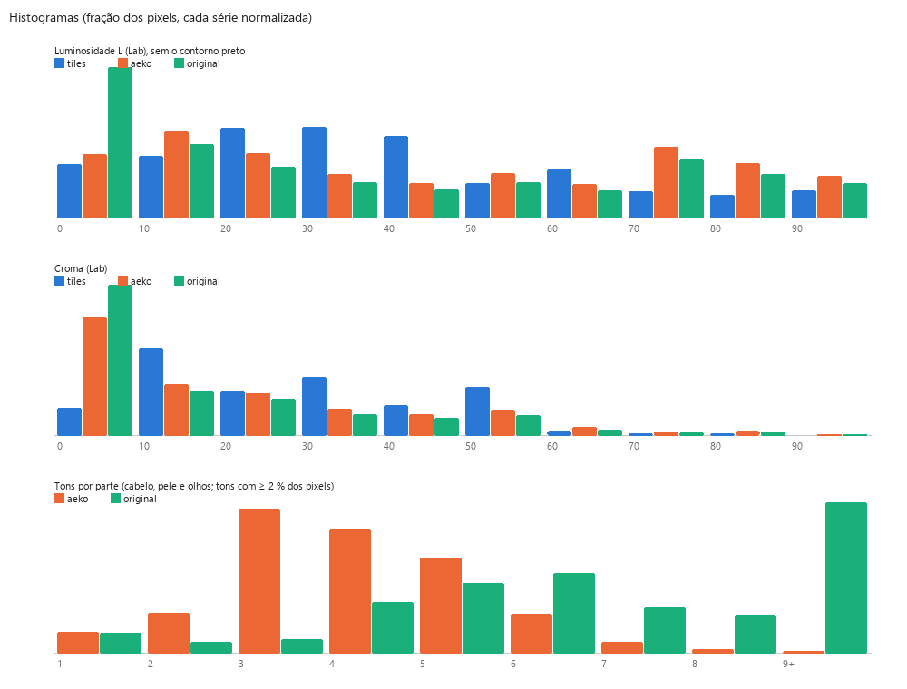
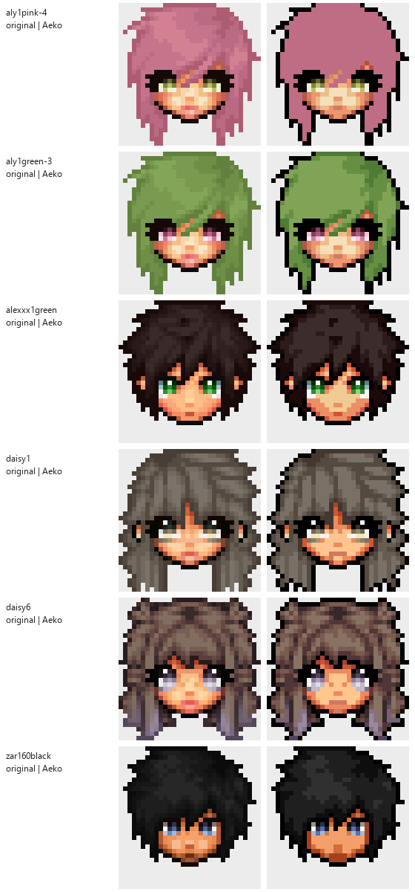

# Estudo: a paleta do Aeko, e o Aeko + equipe

Gerado por `tools/estudo_aeko.py` em 2026-10-20, a partir do que sobreviveu à formatação: as folhas de tiles do
Aeko (`aeko.casa.0/1`, `aeko.castelo.0/1`), as 947 peças dos contribuidores do Graal nos dois estilos
(`graal.aeko.<n>.png` e `graal.original.<n>.png`, casadas célula a célula) e `src/shared/graalData.ts` e
`graalDataOriginal.ts`. As imagens estão em `estudo/aeko/`. O que é dedução sobre a ferramenta perdida
(`tools/estilo_aeko.py`, que recoloria as peças da equipe na paleta do Aeko) está marcado **(palpite)**.

Em uma frase: nos tiles, o Aeko pinta com poucas cores (451 em quatro folhas), contorno preto puro e
rampas que descem para o preto perdendo croma, quase sem girar o matiz; nas peças da equipe, a ferramenta perdida não
aplicava essa paleta, e sim o jeito dela: pôs o contorno preto e reduziu os tons de cada parte à metade
(degraus de L duas vezes maiores), mantendo o matiz e o croma do contribuidor.

## 1. A paleta do Aeko nos tiles

Só os tiles de 16×16 sem pixel do quadriculado das exportações (634,880 pixels).

- **451 cores** distintas. O preto do contorno (`010000`) é 3.5 % dos pixels; cinzas
  (croma < 6) 25.9 %.
- Croma médio das cores com matiz: **30** (Lab). Luminosidade entre 6 e 89 (p5–p95).
- Famílias de matiz (9 com mais de 0,4 % dos pixels): em média **7.2 tons** por família
  (tons com ≥ 3 % dos pixels da família; uma família junta as rampas de vários objetos do mesmo matiz, então é
  mais que uma rampa), **ΔL mediano de 4.2** entre tons vizinhos de uma família.
- Sombra: o tom mais escuro de cada família tem croma 20 e o mais claro 47 (em média):
  a sombra do Aeko vai na direção do preto, perdendo croma, não de uma cor saturada; o matiz gira
  -2° do escuro para o claro (mediana das famílias), ou seja, quase não há hue shift (as exceções
  estão na tabela: o amarelo esverdeia ao clarear, o azul vai para o roxo ao escurecer). O contorno é preto
  puro em volta de tudo, não um escuro da própria cor — nas peças originais dos contribuidores o contorno é um
  escuro da cor da parte (ver a seção 2).

| família | pixels | tons | ΔL mediano | croma médio | croma escuro → claro | matiz escuro → claro |
|---|---|---|---|---|---|---|
| azul (280°) | 20.1 % | 7 | 3.4 | 20 | 14 → 20 | 280° → 268° |
| amarelo-terra (54°) | 16.0 % | 9 | 4.3 | 41 | 26 → 50 | 57° → 57° |
| laranja (39°) | 12.5 % | 8 | 2.6 | 36 | 11 → 50 | 43° → 32° |
| amarelo (95°) | 10.1 % | 7 | 4.7 | 17 | 6 → 16 | 86° → 107° |
| verde (139°) | 4.0 % | 5 | 7.5 | 37 | 33 → 38 | 136° → 145° |
| rosa (334°) | 3.8 % | 9 | 6.2 | 32 | 20 → 38 | 328° → 329° |
| amarelo-terra (66°) | 2.2 % | 8 | 2.6 | 54 | 40 → 84 | 68° → 65° |
| verde (158°) | 0.7 % | 5 | 5.7 | 27 | 16 → 33 | 163° → 157° |
| roxo (298°) | 0.6 % | 7 | 5.0 | 50 | 16 → 94 | 309° → 295° |

## 2. As peças: original × Aeko

Medido nas 947 peças (camada f de cada uma), separando as partes pelas máscaras (cabelo h, pele s, olhos e,
enfeites d, roupa c). Pixels pretos (contorno) fora das contas de tons.

- Cores por peça: **41 no original → 19 no Aeko**.
- Contorno: no original, 8.9 % dos pixels da borda da silhueta são pretos (L médio da borda
  19); no Aeko, **100.0 %**. O preto é 20.1 % dos pixels de uma
  peça no Aeko, 3.7 % no original.
- Tons por parte, degraus e croma:

| parte | tons (orig → Aeko) | ΔL entre tons (orig → Aeko) | croma médio (orig → Aeko) | matiz escuro→claro (orig → Aeko) |
|---|---|---|---|---|
| cabelo | 5.8 → 3.5 | 4.2 → 8.0 | 17 → 17 | +1.3° → +6.9° |
| pele | 8.9 → 4.0 | 3.7 → 11.0 | 44 → 47 | +26.3° → +25.2° |
| olhos | 7.5 → 4.2 | 7.4 → 15.1 | 31 → 30 | -0.9° → +0.0° |
| enfeites | 4.8 → 2.7 | 2.0 → 8.5 | 36 → 36 | +0.1° → -0.8° |
| roupa | 1.5 → 1.4 | 8.6 → 12.0 | 33 → 34 | +0.7° → +1.5° |

Leitura: a ferramenta cortou os tons pela metade e dobrou os degraus de L (uns 8 no cabelo, 11 na pele);
o croma e o matiz das partes ficaram os do contribuidor (a diferença média de cor entre os dois
estilos, fora o contorno, é de 3 a 5 de ΔE, e a projeção dessa diferença na direção da cor mais próxima da
paleta dos tiles é zero). Nenhuma cor das peças no estilo Aeko aparece nos tiles, a não ser o preto.

## 3. O que a ferramenta perdida fazia (dedução)

1. **Contorno preto `010000`**: todo pixel opaco que encosta na transparência (97 % deles no gabarito) e os
   pixels fora das máscaras com canal máximo abaixo de ~36 (o contorno escuro que o contribuidor pintou).
   O `01` no vermelho vem de converter o preto por Lab e voltar **(palpite)**. O alfa não muda nunca.
2. **Redução de tons por parte**: cada parte pintável perde metade dos tons; os que se fundem viram
   aproximadamente a média ponderada em Lab (é a melhor das hipóteses testadas: médias em RGB, RGB linear,
   HSV, mediana e moda saem piores). O critério de fusão **não foi recuperado**: nenhum limiar de ΔL, ΔE ou
   RGB separa os pares que se fundiram dos que não (70 % de acerto no melhor caso), duas cabeças com a mesma
   forma e os mesmos degraus (aly1pink-4 e aly1green-3) saíram com 1 e 3 tons de cabelo, e os quantizadores
   do Pillow (median cut, octree, max coverage) não reproduzem o gabarito (0 % de pixels iguais). Pode ter
   sido um k-means com inicialização instável **(palpite)**.
3. **Sem paleta fixa**: as cores não foram encaixadas na paleta dos tiles.
4. **Pequenos ajustes**: pele escura mais saturada (+20 % de croma em L 30–50), olhos claros menos (−10 %),
   cabelo com o contraste de L ampliado uns 10 %.
5. **Resto intocado**: o que fica fora das máscaras e não é escuro sai igual (ΔE médio 0,3).

A reconstrução (`tools/estilo_aeko.py`) faz 1, 3, 4 e 5 como medido, e para 2 usa famílias de matiz (corda em
(a, b) de Lab) com partição ótima em L (Jenks), K = round(amplitude de L / degrau) + 1, degrau 7 no cabelo, 26
na pele e 9 no resto. Com os agrupamentos do próprio gabarito (o "oráculo") e as médias em Lab o ΔE médio
ficaria em 2,6: é o teto do método "fundir e tirar a média"; o que falta é a cor exata que a ferramenta dava a
cada grupo.

## 4. Evolução da recolorização

| passo | o que mudou | ΔE médio (200 peças) | observação |
|---|---|---|---|
| 1 | só o contorno preto (borda e resto escuro) e os tons como estão | 3,26 | — |
| 2 | + fusão de tons por Ward normalizado em Lab (limiar 3) | 3,54 | pior: funde tons grandes que o Aeko manteve |
| 3 | Ward com limiar 1,5 | 3,25 | quase nada |
| 4 | famílias de matiz (a, b) + partição ótima em L (Jenks), degraus 7/13/9 | 3,31 | pele piora: a rampa se parte pelo croma |
| 5 | famílias pela corda de matiz (croma geométrico), sem os ajustes lineares | 3,13 |  |
| 6 | degrau da pele 26, tons pequenos contam na amplitude, sem o preto-na-parte | 3,06 |  |
| 7 | croma por L (pele escura +20 %, olhos claros −10 %), beirada da célula não é contorno | 3,02 | nas 947 peças: ΔE 3,04; a nota está no resumo |
| 8 | grade final nas 947 peças: família de matiz 20 e limiar do preto 40 | 3,02 | +0,01 de nota cada; degrau do cabelo 6 e dos olhos 14 pioram |

## 5. Nota e comparação (resumo)

Rodada de `tools/comparar_estilos.py` sobre 947 peças: **nota média 5.57**, ΔE médio 3.02, pixels iguais 26.8 %, na paleta do gabarito (a um JND) 63.7 %, F1 do contorno 0.966.

Ranking "Aeko + equipe" (média das notas por contribuidor, só os com 5 peças ou mais; a tabela inteira está em `estudo/comparacao/notas.md`):

| # | autor | peças | nota média |
|---|---|---|---|
| 1 | bear | 12 | 6.21 |
| 2 | daisy | 22 | 5.83 |
| 3 | gong | 9 | 5.80 |
| 4 | bea | 219 | 5.73 |
| 5 | zar | 458 | 5.68 |
| 6 | ena | 18 | 5.41 |
| 7 | aly | 6 | 5.29 |
| 8 | raskit | 50 | 5.29 |
| 9 | pooka | 28 | 5.06 |
| 10 | nima | 23 | 5.02 |
| 11 | jen | 49 | 4.87 |
| 12 | tal | 15 | 4.64 |
| 13 | chan | 9 | 4.46 |
