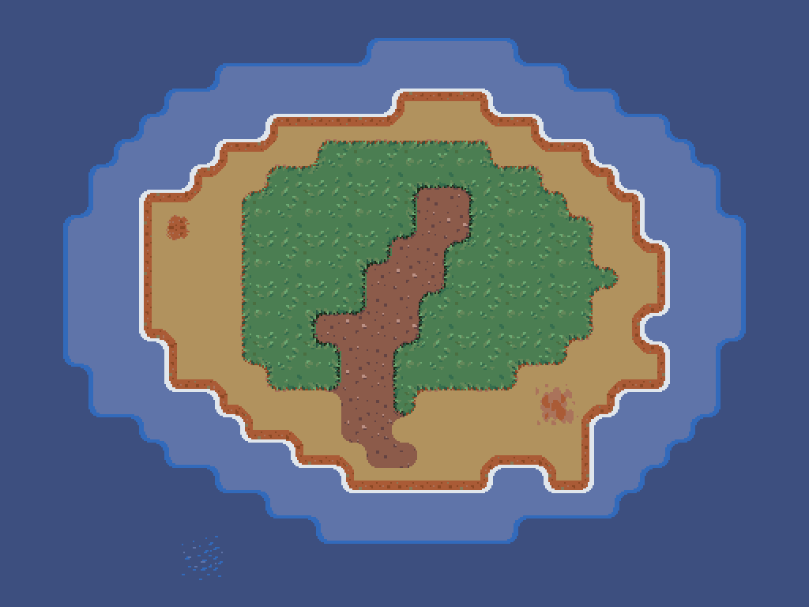
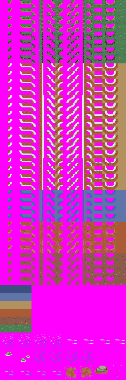
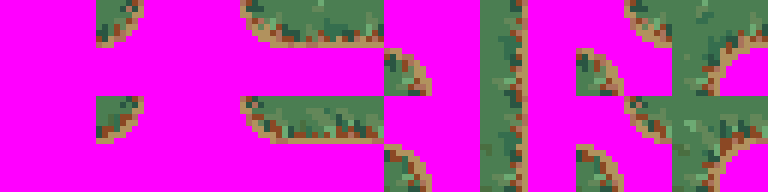
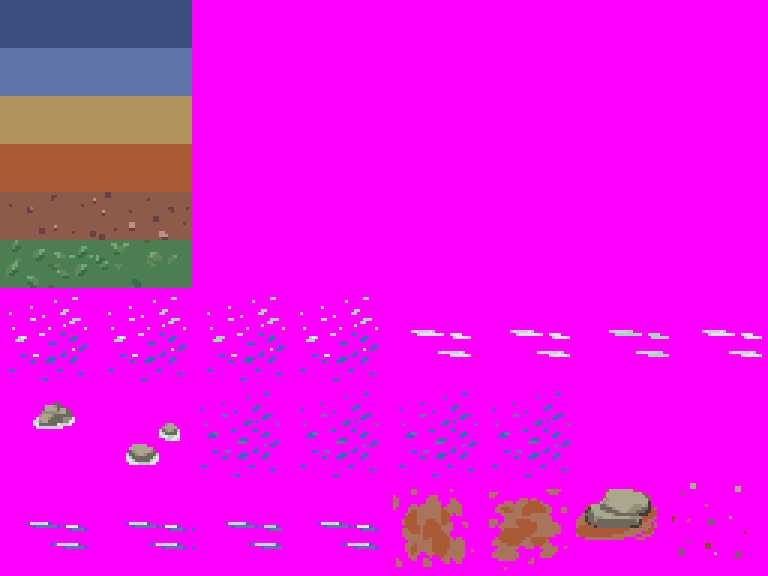
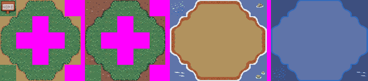
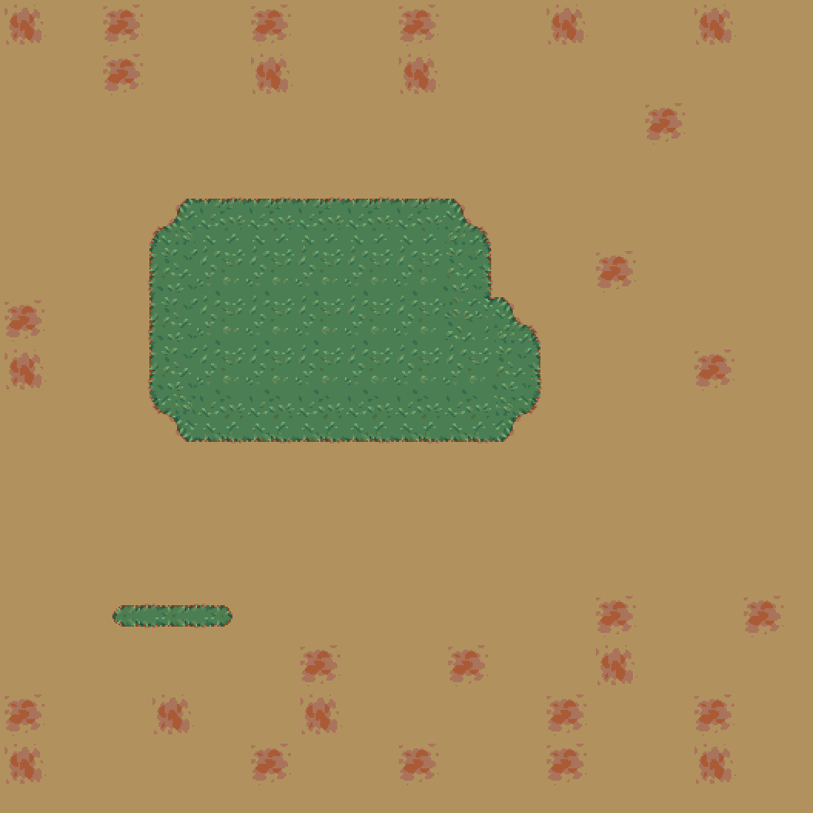

# Exterior: a grade dupla de 16 px e as formas de 32 px (engenharia reversa, 2026-10-20)

Como o gerador compõe `terrain.runs` dos mapas de fora (grama, caminho, areia, mar) a partir de `exterior` do bloco JSON, tirado dos três módulos que têm exterior (`exterior_32`, `exterior_ilha`, `teste_d_ligacoes`) e das duas imagens (`diorama/folhas/folha_juncao.png`, 256 × 768, e `forma_equipe_32.png`, 728 × 160). Os três módulos saem idênticos do gerador novo (`npm run diorama:importar -- --todos` e `npm run diorama:jogo -- --todos`), então o que está aqui reproduz o gerador antigo nesses mapas; o que vai além deles está marcado **(palpite)**. O layout em números fica em `diorama/catalogo/exterior.json`; o código, em `tools/diorama_lib/exterior.mjs`.

`exterior_ilha` desenhado só com os `terrain.runs` do módulo (2×). Mar fundo, mar raso, areia com a espuma animada, grama e o caminho de terra.

## O que é um `ExteriorRun`

`[imagem, i, j, w, h, sx, sy, sw, sh, z, quadros, dx, dy]` (`src/shared/interiors/types.ts`): a imagem (0 `folha_juncao`, 1 `forma_equipe_32`, a ordem de `EXTERIOR_SHEETS`), o canto e o tamanho em células do retângulo do mapa (não do bloco), o recorte em pixels, a camada, os quadros da animação e quanto o recorte anda por quadro. Dois tipos de recorte:

- **cópia 1:1**: `sw = 16 w`, `sh = 16 h`; o retângulo é um pedaço contínuo da imagem.
- **esticado**: `sw = sh = 8`, `sx, sy` = o canto do tile + 4: o miolo de um tile de uma cor só, esticado no retângulo (o `ScaleType.Tile` do Roblox não repete um recorte, `interior.ts`). Só as bases de uma cor só (mar fundo, mar raso, areia, caminho) saem assim.

O gerador monta, por célula do bloco, uma **pilha** de tiles de 16 × 16 (a base embaixo, as junções por cima, o decalque no topo) e junta cada camada `z` em retângulos com o mesmo algoritmo guloso do jogo (`mergeCells` de `src/client/world/interior.ts`, copiado em `tools/diorama_lib/juntar.mjs`): em ordem de leitura, cresce para a direita enquanto o vizinho é o tile seguinte na imagem (mesma imagem e mesma animação), depois para baixo; se o tile é de uma cor só, tenta também crescer entre tiles da mesma cor e fica com o maior retângulo. As camadas saem em ordem (`z` 0 inteira, depois 1, depois 2), cada uma em ordem de leitura; os animados ficam no meio das demais. `terrain.tiles` é o número de células com pilha; `terrain.layers`, o número de tiles somando as pilhas (`exterior_32`: 1089 e 1217; `exterior_ilha`: 768 e 1038; `teste_d_ligacoes`: 4 e 4).

## A folha da junção (`folha_juncao.png`, 16 colunas × 48 linhas de 16 px)

| Linhas | O que é |
|---|---|
| 0–3 | junção **grama sobre areia** (borda marrom) |
| 4–7 | junção **grama sobre terra** |
| 8–11, 12–15, 16–19, 20–23 | junção **areia sobre mar raso**, os 4 quadros da espuma (`quadros` 4, `dy` 64) |
| 24–27 | junção **mar raso sobre mar fundo** |
| 28–31 | junção **caminho sobre areia** (laranja-terroso de uma cor, com pedrinhas) |
| 32–35 | junção **terra sobre areia** (marrom com textura) |
| 36 | base do **mar fundo**, uma cor só `#3d4f7f` (`DEEP_BASE` de `water.ts`) |
| 37 | base do **mar raso**, `#5f74a9` (`SHALLOW_BASE`) |
| 38 | base da **areia**, `#b1925e` |
| 39 | base do **caminho**, `#aa5b36` |
| 40 | base da **terra**, com textura (4 tiles) |
| 41 | base da **grama**, com textura (4 tiles) |
| 42–47 | decalques de 32 × 32 (abaixo) |

**Bases** (linhas 36 a 41, colunas 0 a 3): cada terreno é um padrão de 32 × 32 cortado em quatro tiles postos lado a lado; a célula `(x, y)` do bloco usa a coluna `(y % 2) * 2 + (x % 2)`. Nas bases de uma cor só os quatro são iguais, e o retângulo esticado leva o miolo do tile da primeira célula (por isso `sx` 4, 20, 36 ou 52 em `exterior_ilha`).

**Junções** (4 linhas por par de terrenos): a coluna é a **máscara dos quadrantes** do tile em que aparece o terreno de cima: bit 1 = canto de cima à esquerda, 2 = cima à direita, 4 = baixo à esquerda, 8 = baixo à direita (a coluna 0 é vazia, a 15 é o tile cheio e nunca sai, porque então a célula é toda do terreno de cima e vira base). A linha dentro das 4 é a mesma variante `(y % 2) * 2 + (x % 2)` da base: as quatro linhas são os quartos de um padrão de 32 × 32, e os quadrantes dos tiles vizinhos se encaixam. Conferido pelos pixels (a coluna 1 tem 52 pixels opacos num canto, a 3 tem 128 na metade de cima, a 6 tem 104 em dois cantos opostos, a 15 tem 256) e pelos mapas: os 262 tiles de junção de `exterior_ilha` seguem a variante, sem exceção.

## A grade dupla **(palpite na convenção, certo no resultado)**

O terreno do bloco (`exterior.terreno`) é uma grade de 64 × 64 códigos, um por célula. O desenho é a "grade dupla": o tile desenhado na célula `(x, y)` mostra, nos seus quatro quadrantes, as células de terreno `(x, y)`, `(x + 1, y)`, `(x, y + 1)` e `(x + 1, y + 1)`. Por isso uma área pintada de `n` células vira `n + 1` tiles (`exterior_32`: 32 × 32 células pintadas, 33 × 33 tiles; `teste_d_ligacoes`: 1 célula de grama em (30, 30), 4 tiles em (29–30, 29–30)) e os encontros entre terrenos ficam deslocados meia célula do limite pintado. Qual das duas convenções o plugin antigo usava (a célula de terreno desenhada meia célula para cima e para a esquerda, como aqui, ou para baixo e para a direita) não se vê nos mapas: as duas dão os mesmos recortes, só mudam as coordenadas em `terreno` por 1. Escolhi a de cima porque é a formulação usual da grade dupla (o tile fica no canto entre quatro células) e porque a porta da casa de `exterior_ilha` (saída em (17–19, 8)) cai sobre o topo do caminho de terra (células (17–18, 8)) assim.

Para cada tile, com os terrenos dos quatro quadrantes (os não pintados ficam de fora; sem nenhum pintado não há tile):

1. **A base** é o terreno de **nível mais baixo** entre eles: mar fundo 0 < mar raso 1 < areia 2 < caminho 3 < terra 4 < grama 5. A ordem entre caminho, terra e grama só está provada onde os mapas mostram (grama sobre terra no caminho da ilha, terra e caminho sobre areia) **(palpite nos pares que não aparecem)**.
2. **Uma junção por nível acima da base**, em ordem crescente: a máscara são os quadrantes com nível maior ou igual ao desse terreno; a junção escolhida é a do par (esse terreno, **o nível presente logo abaixo dele no tile**). Na ponta do caminho de `exterior_ilha` isso dá, num tile com areia, terra e grama, a base de areia (`z` 0), a junção terra sobre areia (`z` 1, linhas 32–35) e a grama sobre terra (`z` 2, linhas 4–7); "grama sobre a base" daria linhas 0–3 e não bate. Par sem junção no catálogo: o gerador avisa e não desenha o encontro.
3. **Os decalques** (`exterior.decalques`, `{ x, y, id }`) entram por cima, numa camada igual para as células que cobrem: 1 + a maior pilha debaixo deles. Nos mapas de hoje todos caem em células sem junção (`z` 1).

O que uma célula com terreno diz ao jogo: nunca bloqueia (`blocks` `.`, mesmo no mar); em `actions`, o código do terreno mais alto entre os quadrantes do tile: `~` se só há mar fundo, `6` se o mais alto é mar raso, `.` com terra firme (conferido célula a célula em `exterior_ilha`). O mar raso é pintado (código `r`), não derivado da vizinhança **(palpite: era assim no plugin; nada no jogo distingue)**.

## Os decalques (linhas 42 a 47)

Recortes de 32 × 32 (2 × 2 células), em `diorama/catalogo/exterior.json` (`decalques`); os nomes são meus. Os que os mapas usam: `flor_1` (128, 736) e `flor_2` (160, 736), as moitas de flores vermelhas (31 em `exterior_32`, 1 em `exterior_ilha`), e `brilho_mar` (64, 704), o brilho do mar fundo animado em 4 quadros lado a lado (`dx` 32) em `exterior_ilha`. Os demais **(palpite)**: linhas 42–43, colunas 0–7, quatro quadros de brilho da água rasa; colunas 8–15, quatro quadros de espuma; 44–45, uma pedra grande e duas pequenas; 46–47, mais quatro quadros de espuma, uma pedra na areia e pedrinhas. Os decalques de `exterior_32` estão todos em células pares, como se tivessem sido postos numa grade de 32 px.

## As formas de 32 px (`forma_equipe_32.png`)

Quatro painéis desenhados pela equipe, cada um uma forma de exemplo em blocos de 32 × 32: A grama sobre areia (com a placa HOME em (0, 0) e um retalho de grama em (0, 4)), B grama sobre terra (a partir de x 168), C areia sobre mar raso com pedras (x 336, 6 blocos de largura), D mar raso sobre mar fundo (x 536). O furo em cruz no meio é onde entra a textura da base.

`exterior_32` usa 29 blocos do painel A como **carimbos** em volta de um retângulo de grama: cantos (1, 0), (3, 0), (1, 4), (3, 4), bordas (2, 0), (0, 2), (4, 2), (2, 4), o canto côncavo (3, 1) e o canto (4, 1) onde a forma alarga. Não dá para tirar disso uma regra de vizinhança: dois cantos de cima à direita com a mesma vizinhança (o bloco (3, 0) e o (4, 1)) aparecem em lugares diferentes do mesmo mapa. Então o bloco guarda cada carimbo (`exterior.formas`, `{ x, y, painel, bx, by }`, a célula de cima à esquerda e o bloco do painel) e o gerador só o reproduz: as quatro células do carimbo recebem os quartos do bloco como base e ficam fora da grade dupla (sem junção). As células dentro da forma são pintadas de grama no `terreno` e dão a textura da grama; as de fora são areia. **(palpite: no plugin as formas eram um pincel de carimbo com a paleta do painel; nada nos mapas diz se havia regra automática.)**

## O mar de fora

O mar em volta do retângulo do mapa não está em `terrain.runs`: é `createSea` de `src/client/world/water.ts`, com as imagens `mar.infinito.0–3` (512 × 512, um quadro por imagem) ou, sem elas, a base da linha 36 esticada. O gerador não mexe nisso.

## O que o importador faz com um mapa

`tools/diorama_lib/exterior.mjs`, `decomporRuns`: abre os recortes em células, lê cada pilha (a base pela linha da folha, a junção pelo par de terrenos e pela máscara, o decalque e a forma pelo catálogo), reconstrói o terreno (uma célula está pintada quando os quatro tiles em volta dela existem; o terreno dela é o que esses tiles mostram no quadrante dela) e devolve `terreno`, `decalques` e `formas`. O importador gera de novo e compara: se os recortes não saem iguais, guarda os crus em `exterior.runs_importados` (com `caixa_importada`) e o gerador os copia. Nos três mapas de hoje a grade dupla fecha e não foi preciso.
